# 🌳 YardSquare — Living 3m × 3m What3Words Yard & Botanical Companion

[](./docs/ARCHITECTURE.md)

**YardSquare** (`https://github.com/damiththa/YardSquare`) is a 100% Google Cloud Platform (GCP) native residential plant, tree, and garden bed tracker built on a **26 × 18 (`78m × 54m`) `3m × 3m` (~9.84 ft × 9.84 ft) What3Words property grid**.

---

## ✨ Key Capabilities

1. **Split-Provider $0 Address Autocomplete, 3-Layer Hybrid Auto-Plotter & Per-Address Cloud Memory:**
   - **Stage 1 ($0.00):** `<100ms` US E-911 + **Photon (OpenStreetMap)** type-ahead suggestions (`0` Google Maps quota used).
   - **Stage 2 (3-Layer Hybrid Land & Structure Extraction):** Combines rooftop geocoding with **FEMA USA Structures (LiDAR)** building footprints, **OpenStreetMap Overpass** (`building`, detached garages/sheds, driveways, roads), and a **Satellite `PNG24` `3m`-Patch Auto-Plotter**, plus automatic **USDA Plant Hardiness Zone** detection.
   - **Address-Keyed Cloud Persistence (`yard_addr_<hash>`):** Every searched street address automatically resolves or forks its own persistent Firestore yard without overwriting `yard_default`, syncing across URL (`?yard=...`) and browser storage.
2. **Ultra-HD Live Aerial Satellite Underlay & Polygon Boundary Studio:**
   - **Lossless `PNG24` Progressive Aerial Cascade:** Loads Esri World Imagery at **Zoom Level 21** (`7.5cm/px` / 3-inch orthoimagery), cascading gracefully through **Level 20** (`15cm/px`), **Level 19** (`30cm/px`), **Level 18**, and **USGS NAIP Plus**, paired with whisper-thin hairline grid borders (`9%` opacity) and a subtle dashed fence line.
   - **Interactive Property Border & Structure Tools:** Point-to-point **Polygon Boundary Builder** (supporting L-shaped and irregular parcels), draggable corner handles (`P1..Pn`), `Fence Box` drag designer, 1-click perimeter nudge, and drag-box brushes for **House Roof**, **Garage / Shed**, **Driveway / Patio**, **Septic / Utility Zones**, and **Roads**.
3. **3m × 3m What3Words Grid + 3×3 (`1m × 1m`) Sub-Square Inspector:**
   - Every `3m × 3m` cell has a human-readable code (`R4-C7`), exact WGS84 `(lat, lng)`, sun/shade exposure (`Full Sun`, `Part Shade`, `Full Shade`), and on-demand `///what.three.words` address.
   - Each `3m` square subdivides into a **3×3 micro-grid (`NW, N, NE, W, C, E, SW, S, SE`)** so you can plant a single fruit/shade tree in the center or up to 9 shrubs/vegetables in a raised bed.
4. **Seasonal Companion, Root Safety & Mobile Backyard Walk PWA (`/walk`):**
   - **Seasonal Switcher & Canopy Time-Travel:** Preview your yard across **🌸 Spring**, **☀️ Summer**, **🍂 Autumn**, and **❄️ Winter**, and toggle canopy maturity between **🌱 Today**, **🌿 +5 Years**, and **🌳 +15 Years**.
   - **Root & Canopy Safety Analyzer:** Flags trees with aggressive root systems near house foundations or septic/utility zones, checks canopy overhang, and validates sun/USDA hardiness compatibility.
   - **Mobile Backyard Walk Mode (`/walk`):** Syncs your active address-keyed yard on your phone, converts live browser GPS into your current `3m` What3Words square, highlights nearby plants, and logs 1-tap care (`💧 Watered`, `✂️ Pruned`, `🧺 Harvest`) with offline Service Worker caching.

---

## 🏗️ Cloud-Direct GCP Stack & Tier-1 ($0.00) Cost Guardrails

- **Compute:** Google Cloud Run (`yardsquare-api-dev` & `yardsquare-api-prod`)
- **Database:** Google Cloud Firestore (`dev_yards` vs `prod_yards`) + transparent in-memory local fallback
- **Media Storage:** Google Cloud Storage (`gs://{project}-media/{env}/...`)
- **Secrets:** Google Cloud Secret Manager (`app/services/secret_manager.py`) — **Zero hardcoded secrets or values**
- **Architecture:** [Archify v3.0 System Architecture](./docs/ARCHITECTURE.md) (`/architecture`)

---

## 🚀 Local Development & Testing

```bash
pip install -r requirements.txt
pytest -v
python3 scripts/render_archify.py
uvicorn app.main:app --reload --port 8080
```
