# YardSquare — Archify System Architecture

This document renders the live, repository-backed **Archify v3.0 System Architecture Diagram** for **YardSquare** (`https://github.com/damiththa/YardSquare`).

---

## 🔗 Interactive Archify Views & Artifacts

| Artifact / Endpoint | Description |
| :--- | :--- |
| **[`docs/architecture/yardsquare.architecture.json`](./architecture/yardsquare.architecture.json)** | Authoritative **Archify v3.0** specification (`schema_version: 1`, `quality_profile: "showcase"`, `visual_preset: "blueprint"`) with verified repository source file & line-range citations. |
| **[`docs/architecture/yardsquare-architecture.svg`](./architecture/yardsquare-architecture.svg)** | Standalone SVG rendered in the Archify `blueprint` showcase theme so **GitHub Markdown renders it natively inline** above and in `README.md`. |
| **[`docs/architecture/yardsquare-architecture.html`](./architecture/yardsquare-architecture.html)** | Full interactive **Archify v3.0 Viewer** (pan/zoom, guided views, trace animation, semantic radar, and clickable GitHub source beacons). |
| **[Live Interactive Viewer (`/architecture`)](../app/static/architecture.html)** | Hosted directly on Cloud Run (`/architecture`) from [`app/static/architecture.html`](../app/static/architecture.html). |
| **[`.github/workflows/archify.yml`](../.github/workflows/archify.yml)** | GitHub Actions workflow that runs the official `tt-a1i/archify` CLI on `ubuntu-latest` (Node.js 20) to validate and render the diagram on GitHub. |

---

## 🔄 Ongoing Architectural Maintenance Rule

> **Mandatory Workflow Rule:** Whenever any architectural, router, service, storage, or CI/CD change is made to YardSquare:
> 1. **Catch, Notify & Ask First:** Flag the architectural impact, inform the user, and ask for confirmation before modifying the architecture specification.
> 2. **Update Specification:** Update [`docs/architecture/yardsquare.architecture.json`](./architecture/yardsquare.architecture.json) (components, boundaries, connections, guided views, cards, and `sources` line ranges).
> 3. **Re-Compile Artifacts:** Run `python3 scripts/render_archify.py` (and/or the GitHub Actions `Render & Verify Archify Architecture` workflow) so `docs/architecture/yardsquare-architecture.svg`, `docs/architecture/yardsquare-architecture.html`, and `app/static/architecture.html` stay 100% synchronized.
